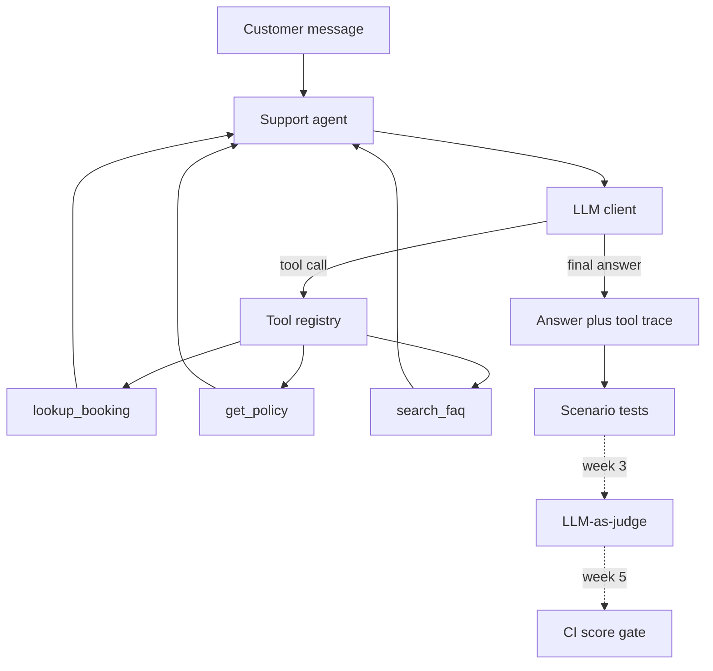

# LLM Agent Eval Harness

[](https://github.com/hKotla/llm-agent-eval-harness/actions/workflows/ci.yml)

A small **Harbor Air** support agent (bookings, baggage, cancellations, FAQ) and the harness used to test it. The agent can call tools. The harness checks that it called the right one and did not invent the answer.

Tool-using agents fail in specific, testable ways: the wrong tool, a booking that is not in the database, a fee that is not in the policy, an instruction buried in the customer message. This repo treats those as defects. It is a portfolio project for evaluating LLM agents, built in the open over six weeks.

Built by [Hari (@hKotla)](https://github.com/hKotla), a test analyst moving into GenAI work. An earlier project, [RAG_pipeline](https://github.com/hKotla/RAG_pipeline), evaluates retrieval. This one starts from the agent and its tools.

## Architecture

The customer message enters a short loop. The model either answers or names a tool. Tools are ordinary Python functions over a fixed table, so a failing test points at the agent. Scenario tests read the answer and the tool trace. The judge and the CI score gate are later weeks, drawn with dashed lines.



The LLM client is a small protocol with two implementations:

- **FakeLLM** (default). A deterministic keyword router. No API key, no network. This is what `pytest` and the CLI use out of the box.
- **OpenAICompatibleLLM**. `POST /chat/completions` with tool calling, via the Python standard library. Point `LLM_BASE_URL` at OpenAI, OpenRouter, Groq, Ollama, or any other compatible server.

`ScriptedLLM` replays canned responses so tests can drive the loop without depending on the fake's keywords.

## Repository layout

```
├── support_agent/            # the agent under test
│   ├── agent.py              # tool loop
│   ├── llm.py                # protocol, fake, scripted, OpenAI-compatible
│   ├── config.py             # env vars and optional .env
│   ├── cli.py
│   └── tools/                # lookup_booking, get_policy, search_faq
├── evals/
│   ├── judge.py              # TODO(week-3): accuracy, helpfulness, groundedness
│   └── thresholds.py         # TODO(week-5): scores that fail CI
├── tests/
│   ├── scenarios/            # example cases; TODO(week-2) grow to 20–30
│   ├── evals/                # TODO(week-3)
│   └── redteam/              # TODO(week-4)
├── .github/workflows/ci.yml  # pytest on pull requests; TODO(week-5) score gate
├── .env.example
└── pyproject.toml
```

## Quickstart

Requires Python 3.11+.

```bash
python -m venv .venv
source .venv/bin/activate  # Windows: .venv\Scripts\activate
pip install -e ".[dev]"

pytest
python -m support_agent "What is the status of booking BK-1001?"
```

`pytest` needs no API key. The second command prints a confirmed London–Lisbon booking and the `lookup_booking` trace.

Try the other fixtures: `BK-1002` (cancelled), `BK-1003` (pending), "What is the baggage allowance?", "What are your opening hours?".

To call a real model later:

```bash
cp .env.example .env
# set LLM_PROVIDER=openai, LLM_API_KEY, and if needed LLM_BASE_URL and LLM_MODEL
python -m support_agent "What is the baggage allowance?"
```

The model must support tool calling. Leave `LLM_PROVIDER=fake` for everyday development.

## Tests

```bash
pytest -v
```

Six example scenarios live in [`tests/scenarios/cases.py`](tests/scenarios/cases.py). Each one records the customer message, the tools that should run, and phrases the answer must or must not contain. Copy a `Scenario` entry to add another. Two further tests are skipped on purpose (`tests/evals`, `tests/redteam`) until those weeks are built. GitHub Actions runs this same command on every pull request.

The example assertions match FakeLLM's wording, so they stay stable offline. A real model will phrase answers differently. Week 3 is where that scoring belongs.

## Roadmap

About three hours a week. Week 1 is this skeleton. Later weeks are marked `TODO(week-N)` in the tree and are left unfinished on purpose.

- [ ] **Week 1 — Agent with tools (in progress).** Harbor Air agent, three deterministic tools, fake LLM, example scenarios. Start here: run `pytest`, run the CLI, read `support_agent/agent.py` and `FakeLLM`, then add one booking and one scenario yourself.
- [ ] **Week 2 — Scenario suite.** Grow `tests/scenarios/cases.py` to 20–30 cases: happy paths, edge cases, wrong tool use.
- [ ] **Week 3 — LLM-as-judge.** Score accuracy, helpfulness, and groundedness in `evals/judge.py`.
- [ ] **Week 4 — Red team.** Prompt injection, jailbreaks, and data leakage under `tests/redteam/`.
- [ ] **Week 5 — Quality gate.** Fail the GitHub Actions job when a score drops below `evals/thresholds.py`.
- [ ] **Week 6 — Write-up.** Fill the results table, update the diagram with what you learned, and record what the tests caught.

## Results

Week 6 fills this in from a baseline run. The cells are blank on purpose.

| Suite | Cases | Result | Notes |
| --- | ---: | --- | --- |
| Scenario tests | 6 examples | passing offline | Week 2 expands this to 20–30 |
| Judge: accuracy | — | — | Week 3 |
| Judge: helpfulness | — | — | Week 3 |
| Judge: groundedness | — | — | Week 3 |
| Red team | — | — | Week 4 |

Thresholds are not enforced yet. The Week 5 note is in [`.github/workflows/ci.yml`](.github/workflows/ci.yml).

## License

[MIT](LICENSE)
